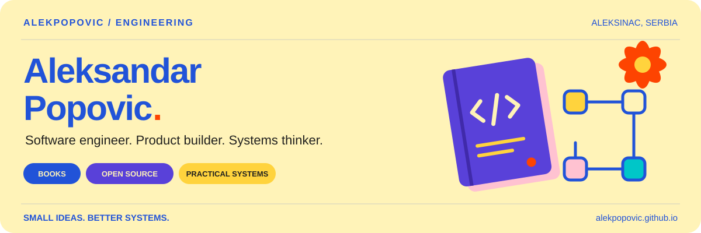
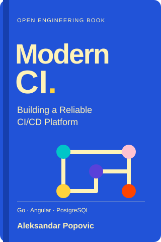
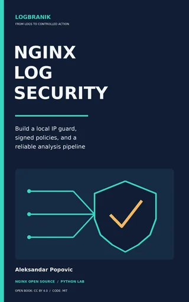
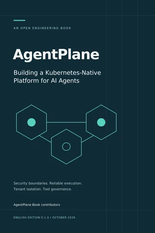
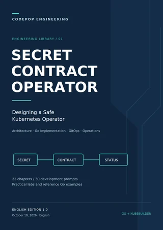
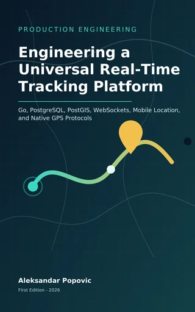

  <a href="https://alekpopovic.github.io/">
    <picture>
      <source media="(prefers-color-scheme: dark)" srcset="./assets/profile-dark.svg">
      
    </picture>
  </a>

# Hi, I'm Aleksandar Popovic.

I build backend services, developer tools, and the infrastructure that keeps them running. I share the engineering behind that work through **books, open-source projects, and practical guides**.

Based in **Aleksinac, Serbia**. Backend development and DevOps at [SpotHopper](https://www.spothopper.com/); founder of [CodePop](https://www.codepop.tech/en/) since 2015.

**[Website ↗](https://alekpopovic.github.io/)** · **[Books](#books--field-guides)** · **[Open source](#selected-open-source)** · **[Technologies](#technologies)** · **[My CV ↗](https://alekpopovic.github.io/cv/)**

## Books & field guides

Complete engineering books with online reading, PDF, and EPUB editions. Each book connects system design with concrete implementation and operating decisions.

| Cover | Book & focus |
| :---: | :--- |
|  | **[Modern CI](https://alekpopovic.github.io/books/modern-ci/)** Building a Reliable CI/CD Platform  Go control planes, PostgreSQL scheduling, dedicated runners, Angular operations, and independently versioned repositories.  [Read online](https://alekpopovic.github.io/books/modern-ci/) · [PDF](https://alekpopovic.github.io/assets/books/modern-ci/downloads/modern-ci-book.pdf) · [EPUB](https://alekpopovic.github.io/assets/books/modern-ci/downloads/modern-ci-book.epub) |
|  | **[Nginx Log Security · LogBranik](https://alekpopovic.github.io/books/logbranik/)** Build a local IP guard, signed policies, and a reliable analysis pipeline  Nginx access logs, trustworthy policy updates, reliable ingestion, and a Python lab with a Go/PostgreSQL production design.  [Read online](https://alekpopovic.github.io/books/logbranik/) · [PDF](https://alekpopovic.github.io/assets/books/logbranik/downloads/nginx-log-security.pdf) · [EPUB](https://alekpopovic.github.io/assets/books/logbranik/downloads/nginx-log-security.epub) |
|  | **[AgentPlane](https://alekpopovic.github.io/books/agentplane/)** Building a Kubernetes-Native Platform for AI Agents  Tenant isolation, durable commands, runtime boundaries, tool approvals, usage accounting, and recovery.  [Read online](https://alekpopovic.github.io/books/agentplane/) · [PDF](https://alekpopovic.github.io/assets/books/agentplane/downloads/AgentPlane-Book.pdf) · [EPUB](https://alekpopovic.github.io/assets/books/agentplane/downloads/AgentPlane-Book.epub) |
|  | **[Secret Contract Operator](https://alekpopovic.github.io/books/secret-contract-operator/)** Designing a Safe Kubernetes Operator  Secret contracts, Go validation, reconciliation, GitOps gates, rotation, testing, and operations.  [Read online](https://alekpopovic.github.io/books/secret-contract-operator/) · [PDF](https://alekpopovic.github.io/assets/books/secret-contract-operator/downloads/secret-contract-operator-book.pdf) · [EPUB](https://alekpopovic.github.io/assets/books/secret-contract-operator/downloads/secret-contract-operator-book.epub) |
|  | **[Engineering a Universal Real-Time Tracking Platform](https://alekpopovic.github.io/books/universal-tracking/)** Go, PostgreSQL, PostGIS, WebSockets, Mobile Location, and Native GPS Protocols  A provider-neutral, multi-tenant location architecture spanning the backend, Angular/Capacitor clients, mobile engines, and GPS devices.  [Read online](https://alekpopovic.github.io/books/universal-tracking/) · [PDF](https://alekpopovic.github.io/assets/books/universal-tracking/downloads/engineering-universal-real-time-tracking-platform.pdf) · [EPUB](https://alekpopovic.github.io/assets/books/universal-tracking/downloads/engineering-universal-real-time-tracking-platform.epub) |

→ [Browse the book library](https://alekpopovic.github.io/books/) · [Read the engineering field notes](https://alekpopovic.github.io/posts/)

## Selected open source

Tools for container orchestration, delivery platforms, infrastructure, and remote operations. Source code and documentation are linked for each project.

### [orch ↗](https://github.com/alekpopovic/orch)

A Go control plane, worker agents, and an operator CLI for small Docker clusters. Scheduling, reconciliation, logs, and deployment events share an explicit operating model.

`Go` `Docker` `REST API` `PostgreSQL store`

[Source](https://github.com/alekpopovic/orch) · [Project story](https://alekpopovic.github.io/projects/orch/) · [Documentation](https://alekpopovic.github.io/orch/)

### [cloudivision ↗](https://github.com/alekpopovic/cloudivision)

Kubernetes-native builds with isolated runner Jobs and observable delivery through GitOps. Build execution and environment reconciliation have separate responsibilities.

`Go` `Kubernetes CRDs` `Angular` `Helm` `GitOps`

[Source](https://github.com/alekpopovic/cloudivision) · [Project story](https://alekpopovic.github.io/projects/cloudivision/) · [Documentation](https://alekpopovic.github.io/cloudivision/)

### [ClusterForge ↗](https://github.com/alekpopovic/clusterforge)

A Go CLI and readable Terraform/OpenTofu modules for container platforms. Generated infrastructure stays available to inspect, plan, and review across Kubernetes, ECS, and Nomad workflows.

`Go` `Terraform` `OpenTofu` `Kubernetes` `ECS` `Nomad`

[Source](https://github.com/alekpopovic/clusterforge) · [Project story](https://alekpopovic.github.io/projects/clusterforge/) · [Documentation](https://alekpopovic.github.io/clusterforge/)

### [ContainerDesk ↗](https://github.com/alekpopovic/container-desk)

A native Linux and macOS workspace for remote Docker hosts over SSH. It reuses OpenSSH configuration and presents containers, logs, and existing Compose groups with explicit management permissions.

`Tauri 2` `React` `TypeScript` `Rust` `OpenSSH`

[Source](https://github.com/alekpopovic/container-desk) · [Project story](https://alekpopovic.github.io/projects/container-desk/) · [Documentation](https://alekpopovic.github.io/container-desk/)

→ [Explore all my repositories](https://github.com/alekpopovic?tab=repositories)

## Technologies

My work connects application engineering with delivery, infrastructure, and useful operating tools.

| Area | Technologies |
| :--- | :--- |
| **Backend & languages** | Ruby · Rails · Go · Python · Elixir · PHP · JavaScript · TypeScript |
| **Interfaces & desktop** | React · Angular · Rust · Tauri |
| **Infrastructure & delivery** | Docker · Kubernetes · AWS · Terraform · OpenTofu · GitOps · GitHub Actions · CI/CD |
| **Data & integration** | PostgreSQL · REST APIs · OpenSSH |

## Learn & connect

- **[AI Lab](https://alekpopovic.github.io/ai/)** — Practical guides to ChatGPT, Codex, Claude, Gemini, Cursor, and Copilot, with commands, workflows, and official sources.
- **[Videos](https://alekpopovic.github.io/videos/)** — Engineering playlists, including DevOps, AWS disaster recovery, and software delivery.
- **[CodePop](https://www.codepop.tech/en/)** — My software engineering company, connecting product development, backend systems, cloud infrastructure, and DevSecOps.

[Email](mailto:aleksandar.popovic@linux.com) · [LinkedIn](https://www.linkedin.com/in/alekpopovic/) · [YouTube](https://www.youtube.com/@aleksandar-popovic-popac) · [X](https://x.com/alek_popovic) · [Instagram](https://www.instagram.com/alekpopicic/) · [Facebook](https://www.facebook.com/popacmozgovo)

---

**Small ideas. Better systems.** · [alekpopovic.github.io](https://alekpopovic.github.io/)
